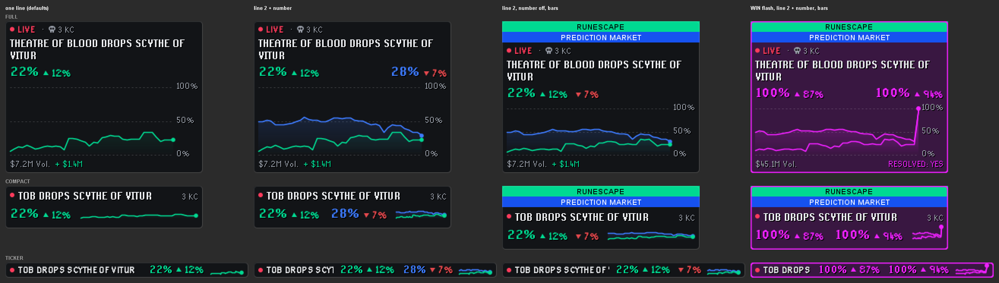

# Prediction Market Drops

A tiny, purely-for-fun overlay that turns your next big drop into a prediction-market-style odds graph. **The odds are completely made up** — this isn't tied to any real drop rates, trading, or gambling, it's just flavor for flexing on your clanmates while you grind.



_Rows: Full, Compact and Ticker. Columns: one line, a second line with its number, a second line with header bars, and a win._

## How it works

- Fighting a boss, running a raid, or training a skill opens a "market" for its best drop (e.g. **ZULRAH DROPS TANZANITE FANG**), with a little line that wanders up and down every few ticks.
- Low-value or already-unlocked drops just show **LIVE ODDS** (with a session timer) instead of picking a specific item.
- Actually land the drop and the line rockets to 100%, flashing raid purple to celebrate.
- Pets get a rare chance of being featured too, logged or not.
- Idle for a while and it resets back to LIVE ODDS.

A drop only counts as a win if it's worth at least the **Win Minimum Drop Value** (2m by default, entered in k, m or b). Items with no GE price — untradeable, or brand new content the GE hasn't priced yet — count if they're a real collection log chase, so new raid uniques work from day one. A collection log item new to your account always counts, whatever it's worth. Repeats of common log items (demon tears, bolt racks) are price-checked against Win Minimum Drop Value like any other drop.

## Settings

- Settings are grouped into sections: drop lists, market & win rules, celebration, data sources, graph lines and header bars
- Colors for both lines, both header bars, and their text
- A second, independently-moving line and a second header bar, each optional
- **Priority drops** (always a win, and bet on instead of the default pick) and a **blacklist** (never bet on or celebrated; trumps everything) (`Source: Item` per line)
- **Win Minimum Drop Value** (what counts as a win) and **Market Minimum Drop Value** (which monsters get a market), in the denomination chosen under **Value Units** (k by default)
- **Overlay Layout**: Full, Compact or Ticker
- **Flash Purple on Win**, **Win Sound** (built-in game sounds), **Celebration Seconds**, and **Resolve Win on Every Drop** (every drop is a win)
- Optional RuneProfile sync, and optional live OSRS Wiki lookups for monsters missing from the bundled tables

Alt-drag the bottom-right corner to resize the overlay.

## Drop data

Most drop tables ship inside the plugin as a snapshot of the [OSRS Wiki](https://oldschool.runescape.wiki/) drop data, so no network request is made for them. Regenerate the snapshot before each release:

```
node tools/generate-wiki-drops.mjs
```

Drop data © OSRS Wiki contributors, [CC BY-NC-SA 3.0](https://creativecommons.org/licenses/by-nc-sa/3.0/).
